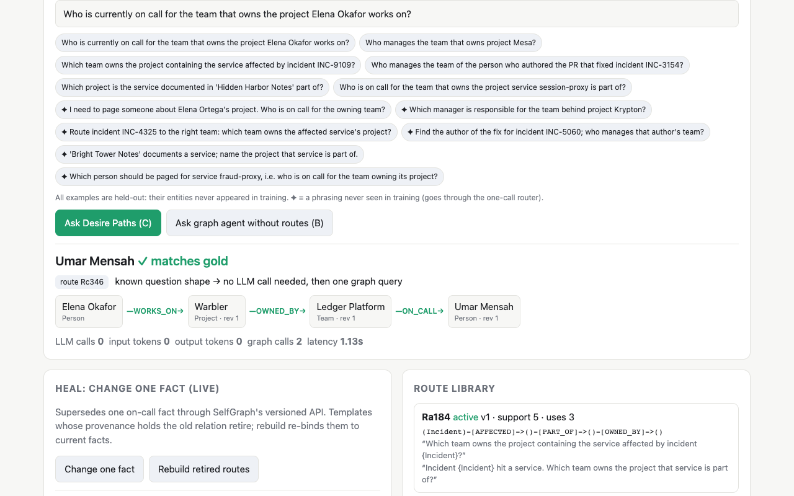
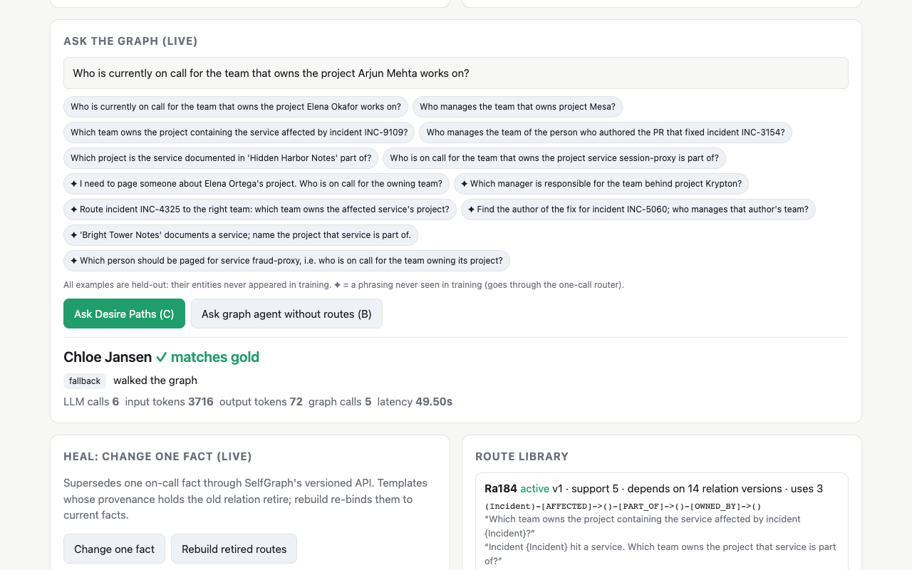
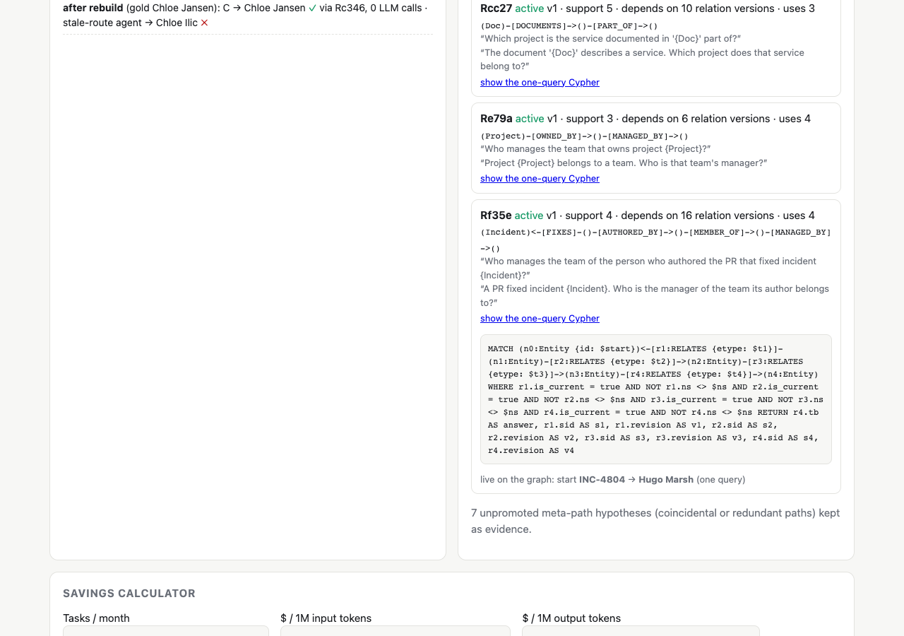

# Desire Paths

[](https://github.com/Jmohak2004/desire-paths/actions/workflows/test.yml)

**Agent cost per task falls as your graph is used.**

**Live demo:** https://denver-spokesman-music-wall.trycloudflare.com (interactive, served from a self-hosted HydraDB
node) · **Always-up snapshot:** https://jmohak2004.github.io/desire-paths/ (measured results; read-only) ·
HydraDB hackathon, **Track 1: the self-improving graph**. Learned path compression: the graph learns, from its own
correct answers, which typed paths to compile into single queries.

Desire Paths is a context layer on [HydraDB](https://github.com/hydra-db/hydradb) and
[SelfGraph](https://github.com/hydra-db/selfgraph). It watches how agents walk the graph to answer multi-hop
questions and learns **route templates** from the walks that worked. A template is a typed path, such as
`(Person)-[WORKS_ON]->()-[OWNED_BY]->()-[ON_CALL]->()`. On a **new** question about entities it has never seen,
the agent runs the template as **one HydraDB query** instead of one LLM call per hop. Each template records the
relation ids and versions it was learned from. When one of those facts changes, the dependent templates retire and
rebuild themselves against the current graph.

> Desire path (n.): the trail worn into the grass by people taking the route the pavement should have taken.

<!-- RESULTS:START -->
## Results (measured, `make eval`)

Held-out questions about entities never seen in training. Seeds [0, 1, 2] (mean ± std across seeds), model `gemma-4-26b-a4b-it` at temperature 0, backend **hydradb**, generated 2026-11-16 11:20:59.
- **Accuracy rises with use:** held-out questions answered correctly within a budget of 1 LLM call go from **0.00 to 0.95 ± 0.01** over 4 rounds. The graph agent without routes (B) scores 0.00 under the same budget, vector RAG (A) 0.02.

- After 4 learning rounds, **C uses 89% fewer LLM calls and 90% fewer tokens per task than B** (the same agent without routes), at accuracy 1.00 vs 0.99.
- Iterative vector RAG (A) reaches 0.71 accuracy on the same questions.


#### Held-out, after 4 learning rounds

| agent | accuracy | LLM calls / q | input tok / q | output tok / q | latency s / q | graph calls / q |
|---|---|---|---|---|---|---|
| A_vector | 0.71 ± 0.03 | 2.52 ± 0.03 | 705 ± 9 | 28 ± 0 | 21.58 ± 0.80 | 0.0 ± 0.0 |
| B_graph | 0.99 ± 0.01 | 4.87 ± 0.05 | 3129 ± 6 | 66 ± 0 | 23.52 ± 2.75 | 3.9 ± 0.0 |
| C_desire | 1.00 ± 0.00 | 0.54 ± 0.07 | 317 ± 37 | 9 ± 1 | 9.84 ± 1.91 | 2.4 ± 0.0 |


#### Held-out, round 0 (before any learning)

| agent | accuracy | LLM calls / q | input tok / q | output tok / q | latency s / q | graph calls / q |
|---|---|---|---|---|---|---|
| A_vector | 0.71 ± 0.03 | 2.52 ± 0.03 | 705 ± 9 | 28 ± 0 | 21.58 ± 0.80 | 0.0 ± 0.0 |
| B_graph | 0.99 ± 0.01 | 4.87 ± 0.05 | 3129 ± 6 | 66 ± 0 | 23.52 ± 2.75 | 3.9 ± 0.0 |
| C_desire | 0.99 ± 0.01 | 4.87 ± 0.05 | 3129 ± 6 | 66 ± 0 | 23.78 ± 2.79 | 3.9 ± 0.0 |


#### Learning curve (held-out, per round)

Accuracy within a budget of 1 LLM call per question (a hard cap: an answer that needs more calls counts as wrong). A and B hold no learning state, so their values are the same every round.

| round | C: accuracy @ 1 call | C: accuracy @ 2 calls | C: accuracy (no cap) | C: LLM calls / q | C: tokens / correct answer | C: routed share | B: accuracy @ 1 call | A: accuracy @ 1 call |
|---|---|---|---|---|---|---|---|---|
| 0 | **0.00 ± 0.00** | 0.00 | 0.99 ± 0.01 | 4.87 ± 0.05 | 3226 | 0.00 | 0.00 | 0.02 |
| 1 | **0.28 ± 0.08** | 0.28 | 0.99 ± 0.01 | 4.24 ± 0.34 | 2500 | 0.28 | 0.00 | 0.02 |
| 2 | **0.83 ± 0.14** | 0.83 | 1.00 ± 0.00 | 1.22 ± 0.79 | 747 | 0.83 | 0.00 | 0.02 |
| 3 | **0.95 ± 0.01** | 0.95 | 1.00 ± 0.00 | 0.54 ± 0.07 | 326 | 0.95 | 0.00 | 0.02 |
| 4 | **0.95 ± 0.01** | 0.95 | 1.00 ± 0.00 | 0.54 ± 0.07 | 326 | 0.95 | 0.00 | 0.02 |

A and B hold no learning state: measured once per seed (round 0) and drawn flat across rounds.

### Heal test (`results/heal.json`)

Question: “Who is currently on call for the team that owns the project Arjun Mehta works on?”. One fact changes: on-call for Insights Platform, Chloe Ilic → Chloe Jansen.

| phase | Desire Paths (C) | LLM calls | stale-route agent |
|---|---|---|---|
| before change | Chloe Ilic ✓ (route Rc346) | 0 | Chloe Ilic ✓ |
| after change template retired | Chloe Jansen ✓ (fallback walk) | 6 | Chloe Ilic ✗ |
| after rebuild | Chloe Jansen ✓ (route Rc346) | 0 | Chloe Ilic ✗ |

Retired: Rc346 v1. Rebuilt: Rc346 v2.

### Savings calculator (`results/savings.md`)

Per-task tokens are measured (held-out, final learning round, mean over seeds). Prices are inputs.

| agent | accuracy | LLM calls / task | input tok / task | output tok / task |
|---|---|---|---|---|
| A_vector | 0.71 | 2.52 | 705 | 28 |
| B_graph | 0.99 | 4.87 | 3129 | 66 |
| C_desire | 1.00 | 0.54 | 317 | 9 |

Cost per 1,000 tasks (USD), and per month at 100,000 tasks:

| price point ($/1M in / out) | A_vector | B_graph | C_desire | C vs B saving | C one-time learning |
|---|---|---|---|---|---|
| small-open-model (0.10 / 0.40) | $0.082 ($8/mo) | $0.340 ($34/mo) | $0.035 ($4/mo) | 90% | $0.009 |
| claude-haiku-5-5 list (0.10 / 0.50) | $0.085 ($8/mo) | $0.346 ($35/mo) | $0.036 ($4/mo) | 90% | $0.009 |
| claude-sonnet-5-5 list (2.00 / 10.00) | $1.693 ($169/mo) | $6.922 ($692/mo) | $0.725 ($72/mo) | 90% | $0.185 |
| claude-opus-5-5 list (4.00 / 20.00) | $3.386 ($339/mo) | $13.845 ($1,384/mo) | $1.449 ($145/mo) | 90% | $0.371 |

### Under load (`results/loadtest.md`)

Backend **hydradb**, seed 0: 36 held-out questions × 10 passes per level. `route` = one learned-route query per question; `walk` = one neighbors query per hop along the same path.

| workload | concurrency | throughput (q/s) | p50 ms | p95 ms | p99 ms | errors | correct |
|---|---|---|---|---|---|---|---|
| route | 1 | 10.3 | 41.7 | 357.6 | 447.1 | 0 | 360/360 |
| route | 8 | 24.5 | 150.1 | 1229.7 | 1453.8 | 0 | 360/360 |
| route | 32 | 24.0 | 570.1 | 5023.3 | 5119.9 | 0 | 360/360 |
| route | 64 | 25.7 | 1115.4 | 8822.6 | 8961.2 | 0 | 360/360 |
| walk | 1 | 4.7 | 223.8 | 299.9 | 303.1 | 0 | 360/360 |
| walk | 8 | 15.1 | 527.4 | 782.8 | 843.6 | 0 | 360/360 |
| walk | 32 | 18.5 | 1786.0 | 2475.9 | 2526.5 | 0 | 360/360 |
| walk | 64 | 18.7 | 3390.9 | 4885.8 | 5279.4 | 0 | 360/360 |

Graph work only: the walk here leaves out its ~5 LLM calls per question, which dominate real latency. One learned-route query per question gives higher throughput and a lower median than walking hop by hop, but a worse p95 tail at high concurrency on this single local node. All answers were correct at every level.

HydraDB gate (`make gate`): **passed**: selfgraph_insert, route_single_query, versioned_supersede, neighbors, raw_cypher_fallback.
<!-- RESULTS:END -->

## Demo

Backup recording of the live dashboard: [`docs/demo.mp4`](docs/demo.mp4), made with `make record`. Every answer
in it was computed live against HydraDB. The 60-second script is in [`docs/demo_script.md`](docs/demo_script.md).

| same held-out question: B walks (5 LLM calls) | C uses the learned route (0 LLM calls, 1 graph query) |
|---|---|
|  |  |

| one fact changes: route retires, C walks and is still right | rebuilt route v2: back to 0 LLM calls, new fact |
|---|---|
|  |  |

Every learned route compiles to a single HydraDB query. The dashboard's route library shows each route's support,
the relation versions it depends on, its Cypher, and a live run:



## Go-to-market

**Who pays.** Teams running LLM agents over company knowledge, where the same *kinds* of questions repeat thousands
of times a day about different entities: on-call and incident routing ("who do I page for X?"), ownership and
org lookups, IT and HR helpdesks, support agents over a product catalogue. Their bill grows with every hop the agent
walks, and today they either pay it or hand-write query templates that go stale when the org changes.

**What they get.** Their agent gets cheaper and faster the more it is used, at the same accuracy. Routes are learned,
not hand-written. They generalise to new entities, so this is not an answer cache, and they retire themselves when
the facts they were learned from change.

<!-- GTM:START -->
**Measured economics** (held-out, from `results/savings.json`; prices are list-price inputs). At claude-sonnet-5-5 list (2.00 / 10.00) prices, the same agent costs **$6.92 per 1,000 tasks without routes and $0.72 with Desire Paths**, a saving of $6.20 per 1,000 tasks ($620/month at 100,000 tasks/month), at the same accuracy. One-time learning cost: $0.19. Priced at 20% of the saving, the fee would be $1.24 per 1,000 tasks and the customer keeps $4.96. The dashboard's calculator redoes this at your own volume and prices.
<!-- GTM:END -->

**Business model (hypothesis).**
- **Open source** (this repo, Apache-2.0): the `desirepaths` add-on for SelfGraph and HydraDB, self-hosted. It is the
  wedge: it drops into an existing agent and shows its savings on the team's own traffic.
- **Hosted / managed (paid):** route learning as a service next to HydraDB Cloud, with route-library management, drift
  alerts (routes retired and rebuilt as facts change), a savings dashboard on real traffic, and an SLA.
- **Pricing:** usage-based, priced as a share of the *measured* saving, so the customer always keeps most of it (see
  the line above). Easy to justify, and it grows as the graph is used.

**Why us / defensibility.** The value compounds inside each customer's graph: more traffic means more routes, which
means cheaper traffic. Versioned provenance makes the routes safe on changing facts, which semantic caches and
hand-written templates can't offer. It is built on HydraDB's open-source engine, so it rides the same adoption.

**Validation so far (honest).** No customers or design partners yet; this was built in one night. Next steps: publish
the build (X, LinkedIn, tagging HydraDB), offer free self-hosted pilots to teams running on-call or helpdesk agents,
and measure their savings on real traffic with `make eval`-style held-out tests.

## Why this earns its place over a vector store

A vector store retrieves passages that *look like* the question. A multi-hop question ("who is on call for the team
that owns the project Ana works on?") needs facts that look nothing like it: the on-call person's snippet doesn't
mention Ana. Iterative vector RAG has to guess its way through the hops (baseline A below).

The graph agent (B) gets the hops right but pays one LLM call per hop, every time. Desire Paths (C) keeps B's
accuracy and learns the *shape* of the walk, so after a few uses that shape costs one call. It needs three things a
vector store doesn't have:

- **typed relations**, so a route generalises to any entity of the start type;
- **one-query multi-hop execution**, so a learned route skips the LLM calls for the intermediate hops;
- **versioned facts**, so a route knows when the facts behind it changed.

## How it works

```
 question ─► keyword search (1 graph call) ─► masked shape known? ─yes─► its route ─► ONE Cypher query ─► answer
                                                   │ no                  (0 LLM calls; any entity of that type)
                                                   ▼
                        router (1 LLM call) picks a route + names the start entity ─► entity check ─► ONE query
                                                   │ no route / not resolved
                                                   ▼
                     graph agent walks hop by hop (search / neighbors, 1 LLM call per step)
                                                   │ success signal
                                                   ▼
   trace ─► candidate typed walks through the explored edges ─► verify each with one query (must return exactly the answer)
                                                   │
                                                   ▼
   RouteLibrary: per question shape (the question with its entity masked by type), a meta-path is attached only if it
   explains ≥80% of that shape's successful traces (rejects coincidences: "the PR author happens to be the manager");
   shortest such path wins; promote at support ≥3. Provenance = (relation id, revision) of every supporting trace.
                                                   │
   SelfGraph supersedes a fact ─► on_relation_change(rel_id) ─► dependent templates RETIRE
                                                   │
                       revalidate(): re-bind each support trace on the current graph ─► template vN+1
```

A question shape seen in training maps straight to its route, even when the entity is new, so those questions cost
zero LLM calls. A new phrasing goes through the router, one LLM call. A router mistake during training is logged
as a misroute and does not demote the route. A wrong answer through the shape index does count against the route.

| module | what it does |
|---|---|
| [`desirepaths/routes.py`](desirepaths/routes.py) | traces, candidate walks, verification, shape-attached promotion, provenance, retirement, revalidation |
| [`desirepaths/backend.py`](desirepaths/backend.py) | SelfGraph over HydraDB (or embedded Kuzu); compiles a route to one Cypher query in either dialect |
| [`desirepaths/agents.py`](desirepaths/agents.py) | A vector RAG, B graph agent, C Desire Paths: same LLM, same questions |
| [`desirepaths/llm.py`](desirepaths/llm.py) | one pinned model at temperature 0, metering, request cache that replays measured usage |
| [`bench/gen.py`](bench/gen.py) | seeded synthetic enterprise graph (2,580 nodes / 5,080 edges), 6 question templates, gold answers |
| [`eval/`](eval) | `run.py` (A vs B vs C, rounds, seeds), `heal.py`, `calculator.py` |
| [`dashboard/`](dashboard) | FastAPI + one page: curves, table, live ask, live fact change, route library, calculator |
| [`scripts/gate_hydradb.py`](scripts/gate_hydradb.py) | proves custom writes + Cypher on HydraDB (SelfGraph path and raw Bolt fallback) |

## Run it

```bash
make setup                                  # venv + deps (Python 3.10+; CI runs 3.11, dev box ran 3.13)
cp .env.example .env                        # add NVIDIA_API_KEY; HYDRADB_URI / HYDRADB_TOKEN

# HydraDB v0.4.0 local node (no Docker needed; ~6 min build on Apple silicon)
brew install just cmake pkg-config llvm suite-sparse coreutils cleishm/neo4j/libcypher-parser
git clone --branch v0.4.0 https://github.com/hydra-db/hydradb ~/hydradb
(cd ~/hydradb && BINDGEN_EXTRA_CLANG_ARGS="-I$(brew --prefix)/include" LIBRARY_PATH="$(brew --prefix)/lib" \
   cargo build --locked --release --features server-runtime --bin graph-node)
make hydradb                                # terminal 1: Bolt 127.0.0.1:7687 (telemetry off)
# .env: HYDRADB_URI=bolt://127.0.0.1:7687  HYDRADB_TOKEN=local-development-token-32-bytes

make gate        # custom nodes/edges + Cypher on HydraDB  -> results/gate_hydradb.json
make test        # route learning, execution, retirement, pipeline (runs on HydraDB when configured)
make eval        # 3 seeds x 4 rounds, heal test, calculator -> results/
make dashboard   # http://127.0.0.1:8000
make record      # backup demo video from the live dashboard -> docs/demo.mp4
make demo        # fresh HydraDB node + dashboard in one command (what to run before recording)
```

### Deploy (always on)

`deploy/Dockerfile` builds one container: HydraDB's open-source `graph-node` compiled from source (v0.4.0) plus the
dashboard. `deploy/start.sh` starts HydraDB inside the container, waits until it is ready, and serves the dashboard on
port 7860. `.github/workflows/image.yml` builds the image, boots it as a smoke test (HydraDB up, graph loaded, a route
answered), and publishes it to `ghcr.io/jmohak2004/desire-paths`. `deploy/hf-space/` is a two-file Hugging Face
Space that runs that image; `deploy/hf_deploy.py` creates the Space and stores `GEMINI_API_KEY` as a Space secret.

Without `HYDRADB_URI`, everything runs on SelfGraph's embedded Kuzu store, and the results record which backend
was used. `make eval` replays LLM responses from `results/cache/llm.jsonl` when the exact request was already made.
The cache replays the token usage and latency measured when the call was made live. `DP_CACHE=off` forces live
calls.

## Honest notes

- **Model.** Every agent uses Gemma 4 (`gemma-4-26b-a4b-it`) through Google's Gemini API, at temperature 0.
  Gemma 4 on NVIDIA's API took 112–200 s per call or timed out, so the first complete run used
  `poolside/laguna-xs-2.1`. That run is archived in [`results/archive/laguna-xs-2.1/`](results/archive/laguna-xs-2.1)
  and reached the same conclusions. `gemma-4-31b-it` took about 32 s per call on the Gemini API, too slow for the
  full eval (evidence: [`results/model_probe.md`](results/model_probe.md)). Switch with `DP_MODEL=...`.
- **Embeddings** for baseline A: `nvidia/nemotron-3-embed-1b`, the only NVIDIA embedder that served this key.
  We tried two stronger A prompts; neither beat the shipped one (see `results/model_probe.md`).
- **A and B have no learning state**, so their numbers cannot change between rounds. They are measured once per
  seed and drawn flat; the results say so.
- **Train/held-out.** Held-out questions use start entities never seen in train, plus a phrasing never seen in
  train. Route learning only ever sees train questions; held-out scoring has learning frozen.
- **Success signal.** In training, success comes from the gold answer. In production it would be user feedback or
  a verifier.
- **Question shapes** are the question text with the entity masked, matched exactly. Held-out questions include a
  phrasing never seen in train; those go through the one-call router. Clustering paraphrases is future work.
- **Known router miss.** 6 of the 108 final held-out questions fall back to the full walk, and all 6 use the same
  unseen phrasing ("I need to page someone about X's project…"). The router picks the wrong route with entity
  "X's project"; the entity check rejects it, so C walks the graph and still answers correctly. It costs about 6 LLM
  calls instead of 1.
- **Run-to-run variation.** HydraDB's keyword search can return tied scores in a different order between runs.
  When a question's entity falls out of the top 5, the shape index misses and the router makes one extra LLM call.
  Re-running `make eval` from the cache reproduced A, B and seed 0 exactly. C's final calls per task were 0.65 on
  the first run and 0.67 on the rerun; accuracy was unchanged.
- **Latency** = measured LLM time per call (NVIDIA free tier, so queueing is included) plus graph time measured on
  every run. Held-out questions are scored one at a time.
- **HydraDB dev-store slowdown.** Over hours of runs the single local node slowed down a lot: a route query went from
  about 7 ms to a 586 ms median, and the test suite from 22 s to 19 minutes. A controlled test, loading the same
  graph into 16 namespaces on a fresh node, showed flat load times, so namespace count alone doesn't explain it.
  A likely contributor (not proven): in `CLOUD_PROVIDER=local` mode, HydraDB's storage garbage collection fails on
  every cycle (`put_opts with PutMode::Update` is not implemented on the local filesystem; the node logs "error
  collecting garbage" for manifests and compactions), so old files are never reclaimed. `make demo` starts from a
  fresh store, and `make hydradb-reset` wipes it. A cloud object store should not have this limitation.
- **HydraDB** here is a single local v0.4.0 node built from source, not HydraDB Cloud. The same code points at any
  Bolt endpoint via `HYDRADB_URI`.

## Use it as a library (SelfGraph add-on)

```bash
pip install -e ".[agents,kuzu]"     # or just the core: pip install -e .
```

```python
from desirepaths import GraphBackend, RouteLibrary, Trace, make_selfgraph, set_relations, verified_paths

set_relations([("WORKS_ON", "Person", "Project", 1), ("OWNED_BY", "Project", "Team", 1), ...])  # your schema
sg, dialect, ns = make_selfgraph("graph.kuzu", schema, fresh=False)   # HydraDB when HYDRADB_URI is set
graph = GraphBackend(sg, dialect, namespace=ns)
lib = RouteLibrary(min_support=3)

# after your agent answers: edges it looked at, entities it searched, answer ids, whether it was right
start, candidates = await verified_paths(graph, explored_edges, searched_ids, answer_ids)
lib.observe(Trace(question, start, start_type, start_name, answer_ids, success, candidates))
lib.promote()

rows = await graph.run_route(lib.active()[0].hops, new_entity_id)   # ONE query, answers + provenance
lib.on_relation_change(retired_relation_id); await lib.revalidate(graph)
```

`desirepaths.agents.DesirePaths` wires all of this into an agent: shape index, then router, then graph-walk
fallback, with online learning.

## Open source

`desirepaths/` is structured as an add-on to SelfGraph. The draft upstream proposal is in
[`docs/upstream_issue.md`](docs/upstream_issue.md). The 60-second demo script is in
[`docs/demo_script.md`](docs/demo_script.md).

License: Apache-2.0.
